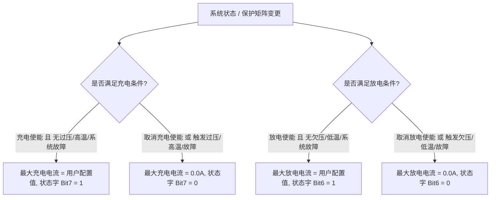

# BMS 多协议仿真与测试工作台 V1.0 (使用说明书)

## 一、 软件概述

**BMS Protocol Simulator** 是专为储能逆变器研发与自动化测试部门打造的单文件便携式测试上位机。无需安装任何 Python 环境或第三方依赖库，双击即可在 Windows 7 / 10 / 11 操作系统上原生稳定运行。

### 核心特性
1. **四大主流协议原生支持（全面适配 3KU 与 6KU）**：
   - **PYLONTECH (RS485 ASCII)**：以官方 Pylon low voltage RS485 规范及 6KU 全特性为基准全面升级：
     - 系统级指令：`60H` (系统基本信息)、`61H` (26项系统模拟量/总压/总流/SOC/SOH/单芯/开尔文温度/循环次数)、`62H` (系统告警与保护状态字)、`63H` (充放电控制/CV/放电截止点/最大充放电限流/使能状态字)、`64H` (系统关机)。
     - 单包/模块级指令：`42H`、`44H`、`47H`、`4FH`、`51H`、`92H`、`93H`、`96H`。
     - **3KU 与 6KU 完美兼容**：6KU 深入解析了 63H 的放电截止电压、最大放电电流、状态字（充电使能、放电使能、强制充电、满充请求）；3KU 接收该标准报文后自动提取其所需字段，两者均 100% 稳定运行。
     - 推荐波特率：`115200` 或 `9600`。
   - **CVTE (Modbus RTU)**：支持读取 12 个保持寄存器（`0x0020` ~ `0x002B`），与 3KU / 5KU / 6KU / VMH 逆变器底层 BMS 驱动 100% 精确对齐。单体电压（`0x0040`~`0x005A`）自适应 8 串 (24V) / 16 串 (48V)。
   - **GROWATT (古瑞瓦特 Modbus RTU)**：严格按照官方规范 `Growatt xxSxxP ESS Protocol` (Rev 2.01) 架构实现。支持 6KU 广域轮询（`0x0001`~`0x0023` 读 35 寄存器）与 3KU 定点轮询（`0x0014`~`0x0022` 读 15 寄存器），全面覆盖规格信息、状态字、Error/Warning 错误与告警字、10mV/10mA/0.1Ah 量纲换算及 8/16 串单体电压。
   - **VOLTRONIC (日月元 Modbus RTU)**：严格按照官方 `Voltronic Power Inverter and BMS 485 Communication Protocol` 规范实现。支持四阶段轮询状态机：`0x0030` (6寄存器: 实时充放电流/0.1V总压/SOC/32位总容量)、`0x0060` (10寄存器: 组端与单体过压/欠压/过流/过温/低温保护告警状态矩阵)、`0x0070` (5寄存器: CV恒压限制/放电截止限制/最大充放限流/0x0074充放电状态字)、`0x0026` (10寄存器: 0.1K 开尔文温度探头)。
2. **3KU / 6KU 双套系独立默认参数与【应用套系 ▾】机制**：
   - **默认参数配置窗口 (⚙)**：职责纯粹化为“修改与保存” 3KU (24V平台) 与 6KU (48V平台) 的默认基准值，点击保存即可写入本地配置文件。
   - **主界面【应用套系 ▾】下拉菜单**：点击即可弹出快捷菜单，一键选择应用 **`3KU 默认参数 (24V)`** 或 **`6KU 默认参数 (48V)`**，数值立即刷新并以绿色高亮提交生效。
3. **全协议专属标志位与模拟量智能拦截提示**：
   - 当选择特定协议时，若用户修改或勾选了该协议非原生支持的字段（例如 Pylontech 下勾选【软起动失败】、CVTE 下提交【放电截止点】、Growatt 下修改【放电截止点】或勾选【请求满充】、Voltronic 下勾选【软起动失败】或【电芯均衡中】），上位机会立即弹出友好的协议差异提示框，避免误测与理解混淆。
4. **三级安全确认与防误触回滚机制**：
   - 绿色闪烁：正常参数提交生效；
   - 黄色闪烁：极限工况警示提示（如极大电流、极端温度、过低/过高 SOC、电压跌破截止点等）；
   - 红色闪烁：非法参数（如剩余容量大于满充容量、放电截止点高于CV点、电压<=0 等）拒绝并自动回滚。
5. **充放电使能与最大电流强联动机制**：
   - 软硬件连锁停充，取消使能或跳闸保护时自动将最大电流归零，确保逆变器可靠停充停放。

---

## 二、 硬件接线指南

### 1. 逆变器 BMS 口 (RJ45 网口) 典型线序
* **Pin 1**: RS485-B (D-) 或 RS485-A（视逆变器具体型号而定）
* **Pin 2**: RS485-A (D+) 或 RS485-B
* **Pin 3 / Pin 6 / Pin 8**: GND (地线)

### 2. 接线步骤
1. 将 USB 转 RS-485 转换器的 **A (D+)** 连接至逆变器 BMS 网口的 **RS485-A**。
2. 将 USB 转 RS-485 转换器的 **B (D-)** 连接至逆变器 BMS 网口的 **RS485-B**。
3. （强烈推荐）连接 GND 地线以消除共模电平干扰。

---

## 三、 参数范围与 3KU / 6KU 基准参数对照表

在主界面与默认参数配置窗口（⚙）中，各参数均受严格的校验规则约束：

| 参数名称 | 物理单位 | 界面调节范围 | 3KU 基准值 (24V平台) | 6KU 基准值 (48V平台) | 校验与极限工况规则 |
| :--- | :---: | :---: | :---: | :---: | :--- |
| **电池总电压** | V | $0.00 \sim 150.00$ | **28.00** | **53.00** | 必须 $> 0\text{ V}$；精度 0.01V，步长 0.1V |
| **充放电流** | A | $-500.00 \sim +500.00$ | **0.00** | **0.00** | 正数为充电，负数为放电；$\|I\| \ge 200\text{ A}$ 提示重载大电流 |
| **电池 SOC** | % | $0.0 \sim 100.0$ | **100.0** | **100.0** | $\le 5\%$ 或 $\ge 99\%$ 触发极限 SOC 黄色提示 |
| **健康度 SOH** | % | $0 \sim 100$ | **100** | **100** | 整数百分比，必须在 $0 \sim 100$ 之间 |
| **CV 恒压点** | V | $0.00 \sim 150.00$ | **28.80** | **56.00** | 必须 $> 10\text{ V}$；低于当前电池电压时触发黄色警示 |
| **放电截止点** | V | $0.00 \sim 150.00$ | **21.00** | **42.00** | 必须 $> 0\text{ V}$ 且 $< \text{CV点}$；当前总压 $\le$ 截止点触发极限警示 |
| **剩余容量** | Ah | $0.0 \sim 5000.0$ | **100.0** | **100.0** | **跨参数校验**：不得大于当前满充总容量（超限拒绝并回滚） |
| **满充容量** | Ah | $0.1 \sim 5000.0$ | **100.0** | **100.0** | **跨参数校验**：必须 $> 0\text{ Ah}$，且不得小于当前剩余容量 |
| **最大充电电流** | A | $0.0 \sim 500.0$ | **100.0** | **100.0** | 与【充电使能】及过压/高温/故障保护强联动（禁充时强制 0A） |
| **最大放电电流** | A | $0.0 \sim 500.0$ | **100.0** | **100.0** | 与【放电使能】及欠压/低温/故障保护强联动（禁放时强制 0A） |
| **最高温度** | °C | $-40.0 \sim 120.0$ | **28.0** | **28.0** | $\le -15\text{ °C}$ 或 $\ge 65\text{ °C}$ 提示极端高低温区 |
| **循环次数** | 次 | $0 \sim 65535$ | **50** | **50** | 整数循环数；$\ge 6000\text{ 次}$ 提示高寿命衰减测试 |

---

## 四、 四大主流协议横向排查与智能提示矩阵

上位机全面支持四大协议。针对各协议原生支持范围的差异，系统建立了**非阻塞式智能提示矩阵**：当用户修改或勾选当前协议不支持的特异性参数/状态字时，上位机通过**控件悬停气泡 ToolTip（持续 4 秒自动淡出）与底部状态栏同步文字提示**，既充分告警协议差异，又彻底消除传统模态弹窗对测试连续操作的阻断打扰。

### 1. 各协议下的专属差异与提示行为
1. **Pylontech 模式下**：
   - **【软起动失败】**（CVTE / Growatt 专属）：勾选触发气泡提示，Pylon 规范中无该保护位，不予下发。
   - **【电芯均衡中】**（CVTE / Growatt 专属）：勾选触发气泡提示，Pylon 报文无独立均衡位，仅作本地模拟。
   - **【休眠状态】**（CVTE / Growatt 专属）：勾选触发气泡提示，Pylon 采用 64H 关机帧，仅作本地模拟。
   - **【电池低电量告警】**（CVTE / Growatt 专属）：勾选触发气泡提示，Pylon 通过 61H SOC 或欠压表征。
2. **CVTE 模式下**：
   - **【请求满充】**（Pylontech / Voltronic 专属）：勾选触发气泡提示，CVTE 状态字仅定义强充位，不予下发。
   - **【放电截止点】**（Pylontech / Voltronic 专属）：修改触发气泡提示，CVTE 寄存器无此字段，逆变器依本地或 UVP 截止。
   - **【最大放电电流】**（Pylontech / Voltronic / Growatt 专属）：修改触发气泡提示，CVTE 依据放电使能控制通断。
3. **GROWATT 模式下**：
   - **【放电截止点】**（Pylontech / Voltronic 专属）：修改触发气泡提示，Growatt 协议仅定义 0x0021 CV 电压。
   - **【请求满充】**（Pylontech / Voltronic 专属）：勾选触发气泡提示，Growatt 0x0013 仅定义 Bit 12 强制充电。
4. **VOLTRONIC 模式下**：
   - **【软起动失败】**（CVTE / Growatt 专属）：勾选触发气泡提示，Voltronic 状态矩阵无此位，仅作本地模拟。
   - **【电芯均衡中】**（CVTE / Growatt 专属）：勾选触发气泡提示，Voltronic 0x0074 状态字无此位，仅作本地模拟。
   - **【休眠状态】**（CVTE / Growatt 专属）：勾选触发气泡提示，Voltronic 状态字无此位，仅作本地模拟。
   - **【电芯压差过大】**（CVTE / Growatt 专属）：勾选触发气泡提示，Voltronic 告警矩阵无独立压差位，仅作本地模拟。
   - **【电池低电量告警】**（CVTE / Growatt 专属）：勾选触发气泡提示，Voltronic 通过欠压状态表征，仅作本地模拟。

### 2. 全协议功能与参数支持横向对比矩阵

| 界面控件 / 参数 | Pylontech (派能) | CVTE (Modbus RTU) | GROWATT (古瑞瓦特) | VOLTRONIC (日月元) | 平台适配说明 |
| :--- | :---: | :---: | :---: | :---: | :--- |
| **【电池总电压 (V)】** | ✅ 61H (10mV) | ✅ 0x0021 (10mV) | ✅ 0x0016 (10mV) | ✅ 0x0032 (0.1V) | 3KU/6KU 全量适配 |
| **【充放电流 (A)】** | ✅ 61H (10mA) | ✅ 0x0022 (10mA) | ✅ 0x0017 (10mA) | ✅ 0x0030/31 (0.1A)| 正充负放，全量适配 |
| **【电池 SOC / SOH (%)】** | ✅ 61H (1%) | ✅ 0x0024/2B (1%) | ✅ 0x0015/20 (1%) | ✅ 0x0033 (1%) | 全量适配 |
| **【CV 恒压充电点 (V)】** | ✅ 63H (mV) | ✅ 0x002A (10mV) | ✅ 0x0021 (10mV) | ✅ 0x0070 (0.1V) | 全量适配 |
| **【放电截止点 (V)】** | ✅ 63H (mV) | 💡 气泡提示 | 💡 气泡提示 | ✅ 0x0071 (0.1V) | 6KU Pylon / Voltronic 支持 |
| **【最大充电电流 (A)】** | ✅ 63H (0.1A) | ✅ 0x0029 (10mA) | ✅ 0x0019 (10mA) | ✅ 0x0072 (0.1A) | 联动保护强制归零 |
| **【最大放电电流 (A)】** | ✅ 63H (0.1A) | 💡 气泡提示 | ✅ 0x0023 (10mA) | ✅ 0x0073 (0.1A) | 联动保护强制归零 |
| **【循环次数 (次)】** | ✅ 61H (次) | ✅ 0x002C (次) | ✅ 0x001E (次) | ⚠️ 协议未包含 | 6KU / 3KU 均支持 |
| **【单体电压 (mV)】** | ✅ 61H (1mV) | ✅ 0x0041~ (1mV) | ✅ 0x0071~ (1mV) | ✅ 0x0011~ (0.1V)| 动态 8串 (24V) / 16串 (48V) |
| **【请求强制充电】** | ✅ 63H Bit 5 | ✅ 0x0020 Bit 12 | ✅ 0x0013 Bit 12 | ✅ 0x0074 Bit 5/4 | 均支持拉起强充 |
| **【请求满充】** | ✅ 63H Bit 4 | 💡 气泡提示 | 💡 气泡提示 | ✅ 0x0074 Bit 3 | Pylon / Voltronic 原生支持 |
| **【电芯均衡中】** | 💡 气泡提示 | ✅ 0x0020 Bit 3 | ✅ 0x0013 Bit 3 | 💡 气泡提示 | CVTE / Growatt 专属 |
| **【休眠状态】** | 💡 气泡提示 | ✅ 0x0020 Bit 4 | ✅ 0x0013 Bit 4 | 💡 气泡提示 | CVTE / Growatt 专属 |
| **【软起动失败 (SSP)】** | 💡 气泡提示 | ✅ 0x0027 Bit 8 | ✅ 0x0014 Bit 8 | 💡 气泡提示 | CVTE / Growatt 专属 (故障码 9) |
| **【电芯压差过大】** | ✅ 61H / 62H | ✅ 0x0028 Bit 0 | ✅ 0x0014 Bit 10| 💡 气泡提示 | 各协议状态映射完整 |

---

## 五、 充放电使能与保护连锁控制逻辑

- **禁充机制**：取消勾选【充电使能】或触发【过压/高温/系统故障】时，主界面【最大充电电流 (A)】强制归零（`0.0A`），下发报文中充电使能置 0。
- **禁放机制**：取消勾选【放电使能】或触发【欠压/低温/系统故障】时，主界面【最大放电电流 (A)】强制归零（`0.0A`），下发报文中放电使能置 0。
- **反向智能激活**：在禁充/禁放状态下，若在模拟量面板直接输入 $> 0\text{A}$ 的电流并提交，上位机自动重新激活并勾选使能。

---

## 六、 操作使用指南

### 1. 默认值套系配置 (⚙) 与一键应用套系 (▾)
1. **修改默认值 (⚙)**：
   - 点击主界面模拟量下方的 **`⚙`** 按钮打开“默认参数配置”窗口；
   - 在顶部下拉框中选择 `3KU 默认参数套系 (24V 电池系统)` 或 `6KU 默认参数套系 (48V 电池系统)`；
   - 分别修改选中套系的 12 项默认基准值，点击 **`保存默认值`** 即可持久化保存至 `bms_default_config.ini`；
   - **激活套系防篡改**：保存模板参数时，系统严格保留当前主界面正在激活生效的套系名称 (`ActiveProfileName`)，避免因查看配置模板导致激活套系被意外覆盖。
2. **应用套系 (▾)**：
   - 点击主界面的 **`应用套系 ▾`** 按钮，弹出快捷菜单：
     - **应用 3KU 默认参数 (24V)**
     - **应用 6KU 默认参数 (48V)**
   - 点击对应项后，参数将**立即同步刷新并以绿色高亮提交至主界面和仿真内核**！

### 2. 建立通信连接
1. 打开 `BMS_Protocol_Simulator.exe`；
2. 选择正确的 COM 端口与波特率（Pylontech 推荐 115200/9600，CVTE/Growatt/Voltronic 默认 9600）；
3. 在“BMS协议”下拉框中选择待测逆变器匹配的协议（`CVTE`、`GROWATT`、`VOLTRONIC`、`PYLONTECH`）；
4. 点击 **`打开串口`**，连接成功后左上角状态指示灯亮起绿色 `● 运行中`。

### 3. 参数修改与失焦自动校验提交
- **修改参数**：点击数值输入框输入新数值；
- **失焦自动校验并提交生效**：全面支持符合 Windows 人机工程学的直觉式输入体验：
  - 输入新数值后，按下键盘 **`Enter`** 键或快捷键 **`Ctrl+S`** 立即提交；
  - **点击空白区域、切换至其他控件或失焦时，上位机自动执行量程与合法性校验并直接提交生效**，无需多余按键；
- **输入拦截与撤销回滚**：
  - **非法输入自动拦截**：若输入非数字、超出上下限量程或违背电芯逻辑（如剩余容量大于满充容量），输入框将以浅粉红背景动态闪烁，底部状态栏输出拦截警示，并自动回滚至上一有效值；
  - **主动放弃修改**：输入过程中若需放弃，直接按下键盘 **`Esc`** 键即可立即撤销输入并恢复原值。

### 4. 实时报文监视与导出
- **报文高亮**：正常轮询显示常规色，报警或保护触发时高亮为红色或橙黄色；
- **零 GC 高频性能引擎**：报文日志缓冲区行数检测采用 Win32 原生 `SendMessage EM_GETLINECOUNT` (0x00BA) 机制，实现 $O(1)$ 零内存分配行数统计，杜绝高频通信下触发 Gen0/LOH GC 导致的界面掉帧与卡顿；
- **视口保持**：支持双向视口位置锁定，查阅长报文时界面刷新不会弹回左侧；
- **日志清空与导出**：点击 **`清空`** 清除日志与收发计数；点击 **`导出日志`** 导出为 `.txt` 文件。

---

---

## 六、 协议白名单隔离机制与保护跳闸限流联动

### 1. 跨协议防串线白名单过滤
为了确保逆变器在机型协议配置错误时能准确触发 **56 号 BMS 通信失联告警**，上位机建立了严格的 Modbus 起始地址白名单机制：
- **Growatt 协议**：仅响应 `0x0001~0x0029` 与 `0x0071~0x0080`，收到 Voltronic (`0x0030/0x0060/0x0070`) 或 CVTE (`0x0020`) 查询时直接静默丢弃，不予应答；
- **Voltronic 协议**：仅响应 `0x0030`、`0x0060`、`0x0070`、`0x0026`、`0x0001`、`0x0010`、`0x0011`，对 Growatt / CVTE 查询静默丢弃；
- **CVTE 协议**：仅响应 `0x0011~0x0013`、`0x001C~0x001F`、`0x0020~0x002F`、`0x0040~0x005A`、`0x0065~0x006E`；
- **效果**：当逆变器设置的协议与上位机不符时，上位机不再错误应答，逆变器在 5 秒超时后可正确报出 56 通信故障。

### 2. 3KU / 6KU 告警与保护状态字映射及限流联动
- **保护跳闸强制停充停放**：当触发过压、欠压、过流、短路、过温、欠温或系统故障等保护时：
  * **最大充电限流 (A)** 自动强制归零 (`0.0A`)；
  * **最大放电限流 (A)** 自动强制归零 (`0.0A`)；
  * 对应协议控制字中的【充电使能】与【放电使能】位自动拉低；
- **状态矩阵全量映射**：
  * **Growatt**：`0x0014` 与 `0x0022` 统一置位告警/故障位，放电短路保护精确对应 Bit 1 (SCD)，彻底剔除误置位的 Bit 3 (欠压位)，3KU/6KU 在充/放/待机工况下均可靠触发动作；
  * **Voltronic**：`0x0060~0x0069` 映射过欠压/过流/过欠温，`0x0074` 状态字联动关断使能；
  * **Pylontech**：`62H` 状态字匹配单体/总压/温控掩码，单体过压告警准确置位 `0x80 | 0x20` 高压位（避免误置 0x40 欠压位），`63H` 控制帧下发 `0A` 停充停放。

---

## 七、 主机轮询模式 (Master Poller) 使用说明

除了作为 BMS 从机响应逆变器外，上位机全面支持**逆变器主机模拟模式**，用于对真实的物理电池包（或第三方 BMS 从机）进行主动遥测采集、在线拓扑扫描与通信链路诊断。

### 1. 切换至主机模式与界面深度隔离
1. 在顶部控制栏的“模式”下拉框中选择 **`主机轮询`**；
2. 界面自动实现主从工作模式彻底解耦与隔离：
   - **自动隐藏从机专用控件**：隐藏“应用套系 (3KU/6KU)”连体按钮组与“🔄 自适应识别”复选框，避免现场误操作；
   - **展开主机专属控制栏**：
     - **目标从机 ID**：指定待轮询的目标电池包物理地址（默认 ID 1，支持 0~15）；
     - **`🔍 扫描从机`**：一键弹出进度弹窗并自动探测总线在线从机；
     - **轮询周期**：支持 `100ms`、`200ms`、`500ms` (默认)、`1000ms`、`2000ms` 及 `手动单步`；
     - **`⏸ 暂停 / ▶ 恢复`**：一键挂起或恢复主动周期轮询；
   - **状态栏与提示文案深度隔离**：彻底清除主机模式下“逆变器/监听总线”等词汇污染，右下角明确标识 `协议: {PROTOCOL} [主机轮询模式]`；
   - **提示风格简约素雅**：主机模式下自动隐藏底部冗余的机型自适应横幅，保留中性灰 (`Color.DimGray`) 纯文本提示：`实时监控模式：接收外部电池遥测数据 (只读回显)`，无花哨 Emoji 干扰。

### 2. 在线从机自动扫描与进度弹窗 (`ScanProgressDialog`)
- 点击 **`🔍 扫描从机`** 按钮，上位机立即弹出专属模态进度条弹窗；
- **遥测监控数据隔离**：探测阶段解包采用独立的 `tempScanModel` 进行合法性校验，与主界面绑定的实时遥测模型彻底解耦，杜绝扫描多台电池包时污染当前 UI 监控数值；
- **进度实时反馈**：进度条 (0~100%) 平滑推进，实时显示当前探测目标（如 `正在探测从机 ID: 2 (进度: 2/16)`）以及已发现从机列表（如 `已发现从机: ID 2`）；
- **随时安全取消**：弹窗内置【取消】按钮，用户可随时中途安全中断扫描，取消时状态栏友好提示且不触发误报错弹窗；
- **探测时延优化**：探测窗口优化至 280ms，充分满足 9600 波特率长报文传输时延；
- **自动切换**：扫描完成后进度弹窗自动关闭并弹出汇总提示，自动将当前目标 ID 切换为首个发现的在线从机地址。

### 3. 全指令实机深度解码与实时遥测监控
- **全指令集实机覆盖**：针对主流物理电池包（如派能标准及 JBD-UP16S023 等 8S/16S 方案），主机轮询引擎完整覆盖全部 7 种协议报文：
  - **`42H` (单包模拟量遥测)**：深度解析电芯电压、充放电流、SOC、SOH、剩余容量、满充容量、循环次数及单体温度；
  - **`44H` (单包告警与保护)**：解析过压、欠压、过流、高温、低温等单包状态字；
  - **`92H` (单包充放电配置)**：解析 CV 充电点、放电截止点、最大充电/放电限流与使能状态；
  - **`60H` (系统设备信息)**：读取电池系统型号及规格信息；
  - **`61H` (系统模拟量)**：读取总压、电流、SOC、SOH 及平均温度；
  - **`62H` (系统告警保护)**：解析系统级综合告警与保护字；
  - **`63H` (系统充放控制)**：读取系统充放限流及满充/强充控制位。
- **轮询日志序号严格对齐**：发送日志中轮询相位采用实际发送的序号记录（`Phase: 1/{N}` ~ `Phase: {N}/{N}`），彻底修正相位累加导致的序号偏移与 0 序号显示缺陷；
- **动态拨码地址与数据稳定定标**：
  - 彻底解除 42H 固化的 "01" 地址校验，全面支持拨码为 ID 2 等任意物理地址从机的动态通信与解析；
  - 修复 92H 有符号补码与 63H 编码差异，将最大放电限流稳定锁定在物理保护限流值（如 30.0A），彻底消除数值在 30A 与 625.4A 间跳变的问题；
  - 具备防越界数值钳位与异常报文过滤，消除界面控件异常。

### 4. 模拟量面板动态回显与薄荷绿视觉反馈
- 主机轮询模式下，主界面模拟量面板自动作为**实时遥测仪表盘（只读回显）**；
- 每次接收到外部从机返回的有效报文，解码引擎自动同步更新 12 项数值控件与 20+ 项状态/告警/保护复选框；
- **薄荷绿动态闪烁反馈**：所有更新的数值控件与状态矩阵自动触发 800ms 柔和薄荷绿 (`RGB 220, 252, 231`) 高亮渐变闪烁，为现场测试人员提供清晰直观的物理报文到达视觉确认。

### 5. 通信超时与失联诊断
- 当主机进入轮询且未暂停时，若目标电池包超过 **3.0 秒** 未返回任何有效应答报文，底部状态栏将自动标黄报警：
  `⚠️ [主机模式] BMS 失联警告: 目标 ID:X 超过 3.0s 无应答`；
- 从机一旦重新恢复应答，状态栏立即自动恢复正常遥测提示并重置失联标志。

---

## 八、 机型指纹识别、协议智能自适应与诊断横幅使用指南

为彻底消除测试人员在 3KU 与 6KU 储能逆变器跨机型、跨协议测试时的频繁手动切换繁琐与协议/套系错配风险，上位机内置了**逆变器机型底层指纹识别引擎**、**Dual-Framer 首帧零丢包协议自适应内核**以及**自适应诊断横幅面板**。

### 1. 3KU / 6KU 机型与四大协议指纹特征库

上位机在工作线程解包层对逆变器下发的底层查询报文进行实时指纹匹配，构建了确定性的机型与协议判定引擎：

| 逆变器协议 | 机型识别判定特征 | 判据置信度 | 识别到的底层机型 | 说明与工程背景 |
| :--- | :--- | :---: | :---: | :--- |
| **Growatt (格罗瓦特)** | `0x0014` 起始且长度 `15` | **100%** | **3KU (24V)** | 3KU 逆变器专有 0x0014 遥测轮询序列 |
| **Growatt (格罗瓦特)** | `0x0001` 起始且长度 `35` | **100%** | **6KU (48V)** | 6KU 逆变器标准 0x0001 全量寄存器读取 |
| **Voltronic (沃特龙)** | `0x0070` 起始且长度 `3` | **100%** | **3KU (24V)** | 3KU 逆变器简版控制字轮询 |
| **Voltronic (沃特龙)** | `0x0070` 起始且长度 `5` 或 `0x0026` 起始长度 `10` | **100%** | **6KU (48V)** | 6KU 逆变器扩展控制与单体遥测轮询 |
| **CVTE (视源)** | `0x0020` 起始且长度 `12` | **100%** | **6KU (48V)** | 6KU 储能逆变器专属遥测协议块 |
| **Pylontech (派能)** | ASCII 命令 `CID2 = 60H` (系统参数/协议版本) | **100%** | **6KU (48V)** | 6KU 逆变器专属握手前置查询 |
| **Pylontech (派能)** | ASCII 命令 `CID2 = 61H ~ 63H` (模拟量/告警/控制) | **100%** | **3KU (24V)** | 3KU 逆变器常规三阶段轮询 |

### 2. Dual-Framer 双重解包器与首帧零丢包自适应

- **双流并行解包**：串口接收缓冲区在底层并行挂载 Modbus RTU 二进制解包器与 Pylontech ASCII 变长流式解包器；
- **首帧即时切换**：当处于从机模拟模式并勾选主界面 **`[🔄 智能自适应识别]`**（默认开启）时，上位机在收到逆变器发送的**第一帧数据包**时，工作线程内部即可直接完成协议处理器切换，并在当前通信周期内直接完成正确应答；
- **零丢包与零 56 故障**：无需等待丢包重试，逆变器在接入瞬间即建立正常通信，彻底杜绝开机瞬间报 56 故障的问题。

### 3. 从机模式自适应诊断横幅面板 (Banner) 交互

在从机模拟模式下，主界面【应用套系】下方常驻智能诊断横幅，实时反馈当前物理链路、逆变器机型与上位机配置的匹配状态（主机轮询模式下自动隐藏，避免视觉冗余）：

| 横幅状态 | 视觉标识 | 状态说明 | 交互操作与一键纠正 |
| :--- | :---: | :--- | :--- |
| **未连接** | `○ 灰色` | 串口处于关闭状态 | 提示“串口未连接 (连接后将自动监测机型与协议)” |
| **自适应就绪** | `🔄 蓝色` | 串口打开且已开启智能自适应 | 提示“智能自适应已就绪: 等待逆变器特征报文...” |
| **正在监听** | `○ 灰色` | 串口打开且未开启智能自适应 | 提示“正在监听总线报文 (等待逆变器发送查询...)” |
| **协议不匹配** | `✕ 亮红` | 逆变器发送的协议与上位机当前所选协议不一致 | 右侧弹出 **`[⚡ 一键切换协议]`** 按钮，点击一键无缝切换至匹配协议 |
| **套系不一致** | `⚠ 亮橙` | 逆变器机型 (如 6KU) 与上位机当前参数套系 (如 3KU) 不一致 | 右侧弹出 **`[⚡ 一键应用机型套系]`** 按钮，点击一键加载对应机型预设默认值 |
| **完全匹配** | `✓ 翠绿` | 逆变器机型、协议与上位机套系完全一致 | 提示“✓ 机型与协议匹配: [机型] [协议] 通信正常” |

### 4. 响应式布局与防截断设计
- 横幅采用百分比动态自适应表格网格 (`TableLayoutPanel`)，在任何窗口拉伸、高 DPI 缩放下均自适应对齐；
- 状态图标采用标准 GDI+ 加粗 Unicode 字符（`✕`, `⚠`, `✓`, `○`, `🔄`），消除跨字体渲染挤压；
- 横幅与操作按钮全面集成悬停富文本 ToolTip 提示，提供详尽的操作建议。

### 5. 跨区域工程健壮性与资源管理规约
- **Pylontech ASCII 物理从机 ID 提取**：在指纹探测识别 Pylontech ASCII 报文时，自动提取报文中的 `ADR` 物理地址域（如 `ADR=0x02`），补全 `SlaveId` 与特征签名，消除从机 ID 缺失；
- **跨区域浮点数序列化规范**：配置文件的保存与解析（`bms_default_config.ini`）强制指定 `CultureInfo.InvariantCulture`，确保始终以标准小数点 `.` 保存，并对非英语环境逗号 `,` 小数点具备双向容错解析能力，彻底杜绝欧洲语言系统下的数值解析放大或崩溃缺陷；
- **WinForms GDI/句柄资源安全释放**：窗体关闭时 (`OnFormClosing`) 显式遍历停止并释放全部控件动态闪烁计时器 (`_flashTimers`)、动态推演计时器 (`_dynamicSimTimer`) 及 ToolTip 气泡组件，杜绝自动化测试场景下的系统句柄与后台线程泄漏。

---

## 九、 工程进阶扩展功能指南 (V1.1 新增)

为满足逆变器边缘通信鲁棒性验证、长时充放电闭环推演、现场协议抓包排障及实机主动远控测试需求，上位机新增以下四大工程模块：

### 1. 通信异常与电芯压差故障注入台（从机模式顶部第 2 行）
| 控件名称 | 参数选项 | 测试用途与底层行为 |
| :--- | :---: | :--- |
| **`静默丢包`** | 勾选 / 取消 | 勾选后上位机正常接收并解析逆变器查询，但抑制回传应答帧，用于验证逆变器 **Fault 56 (BMS 通信失联)** 触发计时与恢复重连逻辑。 |
| **`CRC错帧`** | 勾选 / 取消 | 勾选后对回传的 Modbus RTU 末尾 CRC16 或 Pylontech ASCII 末尾 CHKSUM 注入字节翻转错误，用于验证逆变器串口接收状态机的抗干扰与错包丢弃能力。 |
| **`延时`** | `0ms / 50ms / 200ms / 500ms / 1500ms / 5000ms` | 在从机生成应答帧后插入指定毫秒延时再下发，用于测试逆变器轮询超时临界点与半双工 RS485 总线抢占边界。 |
| **`压差`** | `0mV / 30mV / 100mV / 300mV / 500mV` | 动态在 `#1` 电芯叠加正向偏移、在末节电芯叠加负向偏移，同步体现在 `CVTE (0x0041~)`、`Growatt (0x0071~)`、`Voltronic (0x0011~)` 与 `Pylontech (61H/42H)` 报文中，无需勾选布尔位即可模拟真实电芯不均衡。 |

### 2. 动态充放电物理推演与快捷工况预设
1. **`⚡ 动态充放推演`（模拟量面板底部）**：
   - 勾选后启动实验室 60 倍速安时积分推演引擎（1 秒等效 1 分钟充放电时长）：
   - 根据当前设定的正/负电流实时演进 **剩余容量 (Ah)**、**SOC (%)** 与 **电池总电压 (V)**；
   - 当充电推演至 $\text{SOC} \ge 100\%$ 或电压触碰上限时，自动触发【过压保护】并将最大充电电流与实时电流归零；
   - 当放电推演至 $\text{SOC} \le 0\%$ 或电压跌至截止点时，自动触发【欠压保护】与【请求强制充电】，并将最大放电电流归零。
2. **五大一键工况预设（状态与告警矩阵顶部）**：
   - **`⚡ 正常满载`**：一键恢复 `SOC=85%`、充放使能双通、限流恢复设定值、全告警与保护清零；
   - **`🔋 低电强充`**：一键设置 `SOC=4%`、拉起【请求强制充电】与【低电量告警】、禁止放电（放电限流 0A）；
   - **`🛑 过压跳闸`**：一键设置 `SOC=100%`、总压超 CV 点 `+1.2V`、触发过压警告与过压保护跳闸、切断充电限流；
   - **`⚠️ 欠压跳闸`**：一键设置 `SOC=0%`、总压低于截止点 `-1.0V`、触发欠压保护与强充请求、切断放电限流；
   - **`🧹 全清恢复`**：一键清除所有警告与保护跳闸标志，并恢复正常充放电使能与限流。

### 3. 报文深度解剖器与日志实时过滤
1. **双击日志行打开【报文深度解剖器】**：
   - 在右侧“实时监视”黑底日志框中，**鼠标双击任意一行 RX 或 TX 报文**，即可弹出【报文深度解剖器 (`Frame Anatomy Inspector`)】窗口；
   - 自动提取该行十六进制字节流，校验 `Modbus CRC16` 或 `Pylontech ASCII CHKSUM`（给出计算值与报文值对比），并以结构化表格逐字段解析地址码、功能码/CID2、寄存器起始地址、寄存器逐项物理量或 `61H/62H/63H` INFO 数据域，支持一键复制解剖报告。
2. **实时日志过滤栏**：
   - **`仅看告警`**：勾选后仅追加显示包含告警触发、保护跳闸、故障注入或错误码的关键报文，过滤常规周期轮询；
   - **`过滤:` 关键字输入框**：输入任意寄存器地址（如 `0x0070`）、指令码（如 `63H`）或状态词（如 `强充`），实时筛选匹配报文行。

### 4. CSV 遥测时序录制与主机模式主动写控制
1. **`⏺ 录制CSV`（日志面板底部）**：
   - 点击后选择保存路径，即可在从机模拟应答或主机轮询回显时，按毫秒级时间戳将 `Voltage, Current, Temp, SOC, SOH, RemCap, FullCap, MaxChgI, MaxDisI, CVVolt, CutoffVolt, CanChg, CanDis, ForceChg` 实时追加写入标准 CSV 报表，可直接用 Excel 绘制充放电与限流响应曲线。
2. **`⚡ 写控制 ▾`（主机轮询模式顶部第 2 行）**：
   - 在主机轮询模式下，点击 **`⚡ 写控制 ▾`** 下拉菜单，支持向外部在线 BMS 从机（或另一台处于从机模拟模式的上位机）主动插队下发控制指令：
     - **写最大充电电流 (A)** / **写最大放电电流 (A)** / **写 CV 恒压充电点 (V)**（弹出参数输入框，转化为对应协议 `0x06` 写单寄存器指令）；
     - **下发强制充电控制** / **下发 BMS 关机/休眠指令**（支持 Modbus `0x06` 控制字写入及 Pylontech `64H` 远程关机帧）。

