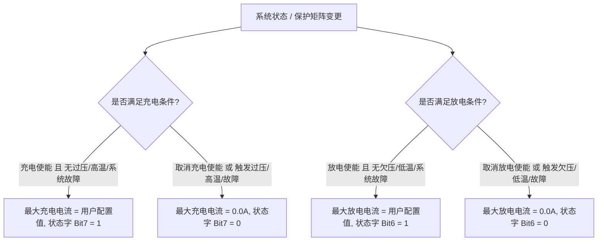

# BMS 协议仿真工具 V1.1 (使用说明书)

## 一、 软件概述

**BMS Protocol Simulator** 是专为储能逆变器研发与自动化测试部门打造的单文件便携式测试上位机。无需安装任何 Python 环境或第三方依赖库，双击即可在 Windows 7 / 10 / 11 操作系统上原生稳定运行。

### 核心特性
1. **六大主流协议原生支持（全面适配 3KU 与 6KU）**：
   - **PYLONTECH (RS485 ASCII)**：以官方 Pylon low voltage RS485 规范及 6KU 全特性为基准：
     - 系统级指令：`60H` (系统基本信息)、`61H` (26项系统模拟量/总压/总流/SOC/SOH/单芯/开尔文温度/循环次数)、`62H` (系统告警与保护状态字)、`63H` (充放电控制/CV/放电截止点/最大充放电限流/使能状态字)、`64H` (系统关机)。
     - 单包/模块级指令：`42H`、`44H`、`47H`、`4FH`、`51H`、`92H`、`93H`、`96H`。
     - **3KU 与 6KU 兼容**：6KU 深入解析了 63H 的放电截止电压、最大放电电流、状态字（充电使能、放电使能、强制充电、满充请求）；3KU 接收该标准报文后自动提取其所需字段，两者均稳定运行。
     - 推荐波特率：`115200` 或 `9600`。
   - **CVTE (Modbus RTU)**：支持读取 12 个保持寄存器（`0x0020` ~ `0x002B`），与 3KU / 5KU / 6KU / VMH 逆变器底层 BMS 驱动精确对齐。单体电压（`0x0040`~`0x005A`）按界面所选【串数】(`8S / 15S / 16S`) 精确填充。
   - **GROWATT (古瑞瓦特 Modbus RTU)**：严格按照官方规范 `Growatt xxSxxP ESS Protocol` (Rev 2.01) 架构实现。支持 6KU 广域轮询（`0x0001`~`0x0023` 读 35 寄存器）与 3KU 定点轮询（`0x0014`~`0x0022` 读 15 寄存器），全面覆盖规格信息、状态字、Error/Warning 错误与告警字、10mV/10mA/0.1Ah 量纲换算及显式 8/15/16 串单体电压。
   - **VOLTRONIC (日月元 Modbus RTU)**：严格按照官方 `Voltronic Power Inverter and BMS 485 Communication Protocol` 规范实现。支持四阶段轮询状态机：`0x0030` (6寄存器: 实时充放电流/0.1V总压/SOC/32位总容量)、`0x0060` (10寄存器: 组端与单体过压/欠压/过流/过温/低温保护告警状态矩阵)、`0x0070` (5寄存器: CV恒压限制/放电截止限制/最大充放限流/0x0074充放电状态字)、`0x0026` (10寄存器: 0.1K 开尔文温度探头)。
   - **SHENGYANG (圣阳锂电标准 Modbus RTU)**：基于通用锂电标准通信规范 V1.30（`0x1000`~`0x1016` 输入寄存器块与 `0x11` 产品信息读取），限定从机地址 `0~15`（`>15` 静默忽略并记录 `[忽略]`），支持 `0x1001` 有符号 `±327.67A` 限幅、`0x1010/0x1011` 无额外温度偏置与型号串数同步。
   - **JBD (小象/嘉佰达二进制协议)**：支持 `0xDD` 帧头的二进制协议，支持读取基础数据 (`0x03`)、单体电压 (`0x04`) 与硬件版本 (`0x05`)；常态 MOS 状态字为 `0x03`，当 `|电流| > 327.67A` 或容量 `> 655.35Ah` 时自动启用 `FET Bit7=1`（`100mA / 100mAh` 分支），保护字 `Bit12` 映射软件锁 MOS，并在日志摘要同步告警与保护高亮提示。
2. **24V / 48V 基准切换、显式串数选择与默认配置持久化**：
   - 模拟量面板底部提供 **`24V (3KU)`** 与 **`48V (6KU)`** 一键基准按钮及 **`串数`** 下拉框（`8S (24V)` / `15S (48V)` / `16S (48V)`），彻底解耦总压与串数，支持 48V 15S/16S 调压至 33V 等低压边界时不误切为 8 串。
   - 首次无配置文件启动时默认 **`48V (6KU / 16S)`**，修改协议、波特率、套系、串数、自适应及 ID 策略后自动持久化保存至程序同目录 `bms_default_config.ini`。
   - 提供 **`自适应识别`** 复选框：开启后，上位机监听逆变器查询帧并自动匹配切换通信协议，**绝不覆盖用户已设定的电压、串数或基准套系**。
3. **协议原生支持精确控制（自动置灰）**：
   - 上位机按当前选定协议自动置灰 (`Enabled = false`) 该协议不支持的模拟量输入框与标志位复选框（例如 CVTE 置灰放电截止点与最大放电限流；Voltronic 置灰循环次数、剩余容量、SOH 与电芯压差等），从源头上防止误操作与无效参数提交。
4. **双级安全确认与防误触回滚机制**：
   - 浅绿高亮闪烁：正常参数校验通过并提交生效；
   - 浅红高亮闪烁：非法参数（超出量程、格式错误、剩余容量大于满充容量、放电截止点高于或等于 CV 点、电压 $\le 0\text{V}$ 等）自动拦截，状态栏提示拦截原因，并自动回滚至上一有效值；支持 Esc 键撤销编辑。
5. **充放电使能与最大电流强联动机制**：
   - 软硬件连锁停充：取消使能或触发保护跳闸时，最大充放电电流自动强制归零，确保逆变器可靠停充停放。

---

## 二、 硬件接线指南

### 1. 逆变器 BMS 口 (RJ45 网口) 典型线序
* **Pin 1**: RS485-B (D-) 或 RS485-A（视逆变器具体型号而定）
* **Pin 2**: RS485-A (D+) 或 RS485-B
* **Pin 3 / Pin 6 / Pin 8**: GND (地线)

### 2. 接线步骤
1. 将 USB 转 RS-485 转换器的 **A (D+)** 连接至逆变器 BMS 网口的 **RS485-A**。
2. 将 USB 转 RS-485 转换器的 **B (D-)** 连接至逆变器 BMS 网口的 **RS485-B**。
3. 连接 GND 地线以消除共模电平干扰。

---

## 三、 参数范围与 24V / 48V 基准参数对照表

在主界面模拟量设定面板中，各参数均受严格的协议与跨参数校验规则约束（无配置文件首次启动默认加载 **48V (6KU / 16S)** 基准）：

| 参数名称 | 物理单位 | 界面/协议有效范围 | 24V (3KU / 8S) 基准 | 48V (6KU / 16S) 基准 | 校验与约束规则 |
| :--- | :---: | :---: | :---: | :---: | :--- |
| **电池总电压** | V | $0.00 \sim 1000.00$（圣阳/JBD $\le 655.35$） | **28.00** | **53.00** | 必须 $> 0\text{ V}$；精度 0.01V，步长 0.1V |
| **充放电流** | A | $-1000.00 \sim +1000.00$（圣阳 $\pm 327.67$） | **0.00** | **0.00** | 正数为充电，负数为放电；JBD 超 $327.67\text{A}$ 自动切 `Bit7=1` |
| **电池 SOC** | % | $0.0 \sim 100.0$ | **100.0** | **100.0** | 必须在 $0.0 \sim 100.0$ 之间；步长 1% |
| **健康度 SOH** | % | $0 \sim 100$ | **100** | **100** | 整数百分比，必须在 $0 \sim 100$ 之间；步长 1% |
| **CV 恒压点** | V | $0.00 \sim 1000.00$（圣阳 $\le 655.35$） | **28.80** | **56.00** | 必须 $> 10\text{ V}$；步长 0.1V（JBD 模式置灰） |
| **放电截止点** | V | $0.00 \sim 1000.00$ | **21.00** | **42.00** | 必须 $> 0\text{ V}$ 且 $< \text{CV点}$；超限自动拦截回滚 |
| **剩余容量** | Ah | $0.0 \sim 10000.0$（圣阳 $\le 655.35$ / JBD $\le 6553.5$） | **100.0** | **100.0** | **跨参数校验**：不得大于当前满充总容量 |
| **满充容量** | Ah | $0.0 \sim 10000.0$（圣阳 $\le 655.35$ / JBD $\le 6553.5$） | **100.0** | **100.0** | **跨参数校验**：必须 $> 0\text{ Ah}$ 且不得小于剩余容量 |
| **最大充电电流** | A | $0.0 \sim 1000.0$（圣阳 $\le 327.67$） | **100.0** | **100.0** | 与【充电使能】及保护联动；JBD 模式置灰 |
| **最大放电电流** | A | $0.0 \sim 1000.0$ | **100.0** | **100.0** | 与【放电使能】及保护联动；JBD/圣阳/CVTE 模式置灰 |
| **最高温度** | °C | $-50.0 \sim 150.0$ | **28.0** | **28.0** | 步长 1°C |
| **循环次数** | 次 | $0 \sim 65535$ | **50** | **50** | 整数循环数；必须 $\ge 0$ |

---

## 四、 六大主流协议特性与控件自动置灰矩阵

上位机支持六大协议。在从机模拟模式下，上位机根据当前选定的协议**自动置灰 (`Enabled = false`) 该协议不支持的模拟量输入框与标志位复选框**，直观屏蔽无效控件；在主机轮询模式下，全部控件保持启用作为只读遥测回显面板。

### 1. 各协议下的专属差异与置灰规则
1. **Pylontech (派能) 模式**：
   - 标志位控件自动置灰：【软起动失败】、【电芯均衡中】、【休眠状态】、【电池低电量告警】（派能规范中未定义此类独立状态位）。
2. **CVTE 模式**：
   - 模拟量控件自动置灰：【放电截止点】、【最大放电电流】（CVTE 保持寄存器无此类字段，放电由使能控制）；
   - 标志位控件自动置灰：【请求满充】（CVTE 仅定义强充位）。
3. **GROWATT (古瑞瓦特) 模式**：
   - 模拟量控件自动置灰：【放电截止点】（Growatt 仅定义 0x0021 CV 充电电压）；
   - 标志位控件自动置灰：【请求满充】（Growatt 0x0013 仅定义 Bit 12 强制充电）。
4. **VOLTRONIC (日月元) 模式**：
   - 模拟量控件自动置灰：【健康度 SOH】、【剩余容量】、【循环次数】（日月元协议未包含此类寄存器）；
   - 标志位控件自动置灰：【软起动失败】、【电芯均衡中】、【休眠状态】、【电芯压差过大】、【电池低电量告警】（日月元状态矩阵无对应独立状态位）。
5. **SHENGYANG (圣阳锂电标准 Modbus) 模式**：
   - 模拟量控件自动置灰：【放电截止点】、【最大放电电流】；切换入圣阳或提交参数时校验有符号电流 (`±327.67A`)、容量 (`≤655.35Ah`) 与电压 (`≤655.35V`) 范围；
   - 标志位控件自动置灰：【请求强制充电】、【请求满充】、【电芯均衡中】、【休眠状态】、【电芯压差过大】、【软起动失败】。
6. **JBD (小象二进制) 模式**：
   - 模拟量控件自动置灰：【健康度 SOH】、【CV 恒压点】、【放电截止点】、【最大充电电流】、【最大放电电流】（JBD `0x03/0x04/0x05` 标准读应答不包含该组参数）；
   - 标志位控件自动置灰：【请求强制充电】、【请求满充】、【休眠状态】；
   - 保护标签动态映射：原【软起动失败】复选框在 JBD 模式下显示为 **`软件锁MOS(Bit12)`**（对应保护字 Bit12）。

### 2. 全协议功能与参数支持横向对比矩阵

> 注：六协议均由主界面【串数】下拉框 (`8S (24V) / 15S (48V) / 16S (48V)`) 显式控制单体电芯数量，不再依据总压 $<35\text{V}$ 或 $<36\text{V}$ 自动降为 8 串。

| 界面控件 / 参数 | Pylontech (派能) | CVTE (Modbus RTU) | GROWATT (古瑞瓦特) | VOLTRONIC (日月元) | 协议适配与置灰规则说明（含 SHENGYANG / JBD） |
| :--- | :---: | :---: | :---: | :---: | :--- |
| **【电池总电压 (V)】** | ✅ 61H (10mV) | ✅ 0x0021 (10mV) | ✅ 0x0016 (10mV) | ✅ 0x0032 (0.1V) | 全协议支持 |
| **【充放电流 (A)】** | ✅ 61H (10mA) | ✅ 0x0022 (10mA) | ✅ 0x0017 (10mA) | ✅ 0x0030/31 (0.1A)| 全协议支持 (正充负放) |
| **【电池 SOC (%)】** | ✅ 61H (1%) | ✅ 0x0024 (1%) | ✅ 0x0015 (1%) | ✅ 0x0033 (1%) | 全协议支持 |
| **【健康度 SOH (%)】** | ✅ 61H (1%) | ✅ 0x002B (1%) | ✅ 0x0020 (1%) | ❌ 自动置灰 (禁用) | 日月元无此字段，自动置灰 |
| **【CV 恒压充电点 (V)】** | ✅ 63H (mV) | ✅ 0x002A (10mV) | ✅ 0x0021 (10mV) | ✅ 0x0070 (0.1V) | 全协议支持 |
| **【放电截止点 (V)】** | ✅ 63H (mV) | ❌ 自动置灰 (禁用) | ❌ 自动置灰 (禁用) | ✅ 0x0071 (0.1V) | CVTE / Growatt 自动置灰 |
| **【剩余容量 (Ah)】** | ✅ 61H (0.1Ah) | ✅ 0x0025 (0.1Ah) | ✅ 0x001A (0.1Ah) | ❌ 自动置灰 (禁用) | 日月元无此字段，自动置灰 |
| **【满充容量 (Ah)】** | ✅ 60H/42H (Ah) | ✅ 0x0026 (0.1Ah) | ✅ 0x001B (0.1Ah) | ✅ 0x0034/35 (32位Ah)| 全协议支持 |
| **【最大充电电流 (A)】** | ✅ 63H (0.1A) | ✅ 0x0029 (10mA) | ✅ 0x0019 (10mA) | ✅ 0x0072 (0.1A) | 全协议支持 (联动保护强制归零) |
| **【最大放电电流 (A)】** | ✅ 63H (0.1A) | ❌ 自动置灰 (禁用) | ✅ 0x0023 (10mA) | ✅ 0x0073 (0.1A) | CVTE 无放电限流寄存器，自动置灰 |
| **【最高温度 (°C)】** | ✅ 61H (0.1K) | ✅ 0x0023 (0.1°C) | ✅ 0x0018 (0.1°C) | ✅ 0x0026~2F (0.1K) | 全协议支持 |
| **【循环次数 (次)】** | ✅ 61H (次) | ✅ 0x002C (次) | ✅ 0x001E (次) | ❌ 自动置灰 (禁用) | 日月元无此字段，自动置灰 |
| **【单体电压 (mV)】** | ✅ 61H (1mV) | ✅ 0x0041~ (1mV) | ✅ 0x0071~ (1mV) | ✅ 0x0011~ (0.1V) | 显式 8S / 15S / 16S；SHENGYANG (0x100D~0x100E)/JBD (0x04) 同步生效 |
| **【请求强制充电】** | ✅ 63H Bit 5 | ✅ 0x0020 Bit 12 | ✅ 0x0013 Bit 12 | ✅ 0x0074 Bit 5/4 | SHENGYANG / JBD 自动置灰 |
| **【请求满充】** | ✅ 63H Bit 4 | ❌ 自动置灰 (禁用) | ❌ 自动置灰 (禁用) | ✅ 0x0074 Bit 3 | Pylon / Voltronic 原生支持 |
| **【电芯均衡中】** | ❌ 自动置灰 (禁用) | ✅ 0x0020 Bit 3 | ✅ 0x0013 Bit 3 | ❌ 自动置灰 (禁用) | CVTE / Growatt / JBD(MOS均衡) 支持 |
| **【休眠状态】** | ❌ 自动置灰 (禁用) | ✅ 0x0020 Bit 4 | ✅ 0x0013 Bit 4 | ❌ 自动置灰 (禁用) | CVTE / Growatt 专属 |
| **【软起动失败 / 软件锁MOS】** | ❌ 自动置灰 (禁用) | ✅ 0x0027 Bit 8 | ✅ 0x0014 Bit 8 | ❌ 自动置灰 (禁用) | JBD 模式标签切换为 `软件锁MOS(Bit12)` |
| **【电芯压差过大】** | ✅ 61H / 62H | ✅ 0x0028 Bit 0 | ✅ 0x0014 Bit 10| ❌ 自动置灰 (禁用) | JBD (0x03 Warn Bit10) 亦支持 |
| **【电池低电量告警】** | ❌ 自动置灰 (禁用) | ✅ 0x0028 Bit 1 | ✅ 0x0014 Bit 9 | ❌ 自动置灰 (禁用) | SHENGYANG (`0x1005 Bit11`) / JBD (`0x03 Warn Bit11`) 亦支持 |

---

## 五、 充放电使能与保护连锁控制逻辑

- **禁充机制**：取消勾选【充电使能】或触发【过压/过流/短路/过温/低温/系统故障/软起动失败】保护跳闸时，主界面【最大充电电流 (A)】强制归零（`0.0A`），下发报文中充电使能位自动清零。
- **禁放机制**：取消勾选【放电使能】或触发【欠压/过流/短路/过温/低温/系统故障/软起动失败】保护跳闸时，主界面【最大放电电流 (A)】强制归零（`0.0A`），下发报文中放电使能位自动清零。
- **反向激活联动**：在禁充或禁放状态下，若在模拟量面板直接输入 $> 0\text{A}$ 的电流并提交，上位机自动重新勾选激活对应的充/放电使能。

---

## 六、 协议白名单隔离机制与保护跳闸限流联动

### 1. 跨协议防串线白名单过滤
为了确保逆变器在机型协议配置错误时能准确触发 **56 号 BMS 通信失联告警**，上位机建立了严格的 Modbus 起始地址白名单机制：
- **Growatt 协议**：仅响应 `0x0001~0x0029` 与 `0x0071~0x0080`，收到 Voltronic (`0x0030/0x0060/0x0070`) 或 CVTE (`0x0020`) 查询时直接静默丢弃，不予应答；
- **Voltronic 协议**：仅响应 `0x0030`、`0x0060`、`0x0070`、`0x0026`、`0x0001`、`0x0010`、`0x0011`，对 Growatt / CVTE 查询静默丢弃；
- **CVTE 协议**：仅响应 `0x0011~0x0013`、`0x001C~0x001F`、`0x0020~0x002F`、`0x0040~0x005A`、`0x0065~0x006E`；
- **测试效果**：当逆变器设置的协议与上位机不符时，上位机不再错误应答，逆变器在 5 秒超时后可正确报出 56 通信故障。

### 2. 3KU / 6KU 告警与保护状态字映射及限流联动
- **保护跳闸强制停充停放**：当触发过压、欠压、过流、短路、过温、欠温或系统故障等保护时：
  * **最大充电限流 (A)** 自动强制归零 (`0.0A`)；
  * **最大放电限流 (A)** 自动强制归零 (`0.0A`)；
  * 对应协议控制字中的【充电使能】与【放电使能】位自动拉低；
- **状态矩阵全量映射**：
  * **Growatt**：`0x0014` 与 `0x0022` 统一置位告警/故障位，放电短路保护精确对应 Bit 1 (SCD)，彻底剔除误置位的 Bit 3 (欠压位)，3KU/6KU 在充/放/待机工况下均可靠触发动作；
  * **Voltronic**：`0x0060~0x0069` 映射过欠压/过流/过欠温，`0x0074` 状态字联动关断使能；
  * **Pylontech**：`62H` 状态字匹配单体/总压/温控掩码，单体过压告警准确置位 `0x80 | 0x20` 高压位（避免误置 0x40 欠压位），`63H` 控制帧下发 `0A` 停充停放。

---

## 七、 操作使用指南

### 1. 24V / 48V 基准切换、串数设定与配置文件持久化
模拟量面板底部提供基准切换、显式串数选择与自适应开关：
- **`24V (3KU)`**：点击后加载 24V 基准（总压 28.00V、CV 28.80V、截止 21.00V、串数 8S）并提交生效；
- **`48V (6KU)`**：点击后加载 48V 基准（总压 53.00V、CV 56.00V、截止 42.00V、串数 16S）并提交生效；
- **`串数` (`8S (24V) / 15S (48V) / 16S (48V)`)**：独立决定单体电芯串数（如 48V 15S/16S 在低压边界 33.00V 时仍输出 15/16 串单体均值，不再误降为 8 串）；
- **`自适应识别`**：勾选后开启纯协议自适应，收到逆变器查询帧时仅自动切换匹配的通信协议，保持用户当前电压与串数设定；
- **默认配置记忆 (`bms_default_config.ini`)**：无文件时默认 **`48V (6KU / 16S)`**，变更协议/波特率/套系/串数/自适应/ID 设置及关闭窗体时自动保存并在下次启动恢复。

### 2. 建立通信连接
1. 打开 `BMS_Protocol_Simulator.exe`；
2. 选择正确的 COM 端口与波特率（Pylontech 推荐 115200/9600，CVTE/Growatt/Voltronic 默认 9600）；
3. 在“协议”下拉框中选择待测逆变器或 BMS 匹配的协议（`CVTE`、`GROWATT`、`VOLTRONIC`、`PYLONTECH`、`SHENGYANG`、`JBD`）；
4. 在“工作模式”中选择 `从机模拟`（默认）或 `主机轮询`；
5. 点击 **`打开串口`**，连接成功后状态栏指示 `● 运行中`；若运行中拔出 USB-485 转换器或端口变更，上位机将自动断开清理并恢复就绪状态，无需重启软件。

### 3. 参数修改与失焦自动校验提交
- **修改参数**：点击数值输入框输入新数值；
- **失焦自动校验并提交生效**：
  - 输入新数值后，按下键盘 **`Enter`** 键或快捷键 **`Ctrl+S`** 立即提交；
  - 点击空白区域、切换至其他控件或失焦时，上位机自动执行量程与合法性校验并直接提交生效，控件呈现浅绿色背景确认闪烁；
- **非法输入拦截与自动回滚**：
  - 若输入非数字、超出允许量程、或违背电池逻辑（如剩余容量大于满充容量、放电截止点高于或等于 CV 点、电压 $\le 0\text{V}$、满充容量 $\le 0\text{Ah}$ 等），输入框以浅红色背景闪烁，底部状态栏输出详细拦截警示，并自动回滚至上一有效值；
  - 输入过程中若需放弃，直接按下键盘 **`Esc`** 键即可撤销当前输入并恢复原值。

### 4. 实时报文监视与日志操作
- **报文高亮**：正常周期轮询显示常规色（TX 天蓝，RX 浅绿）；保护跳闸相关报文以亮红色高亮；告警提示相关报文以亮橙色高亮；
- **零 GC 高频性能引擎**：报文日志缓冲区行数检测采用 Win32 原生 `SendMessage EM_GETLINECOUNT` 机制，实现 $O(1)$ 零内存分配行数统计，杜绝长期运行导致的界面卡顿；
- **视口保持**：非自动滚屏时支持水平与垂直双向滚动位置像素级锁定，查阅长报文时不向左跳动；
- **底部监视控制栏**：
  - **`自动滚屏`**：勾选时新日志追加自动滚至最底端；
  - **`显示时间`**：勾选时在报文前追加 `[HH:mm:ss]` 时间戳；
  - **`显示HEX`**：勾选时显示十六进制原始字节流；
  - **`清空`**：清空日志显示框，并重置 RX、TX、错误计数器；
  - **`导出日志`**：将当前全部日志保存为 `.txt` 或 `.log` 文件；
  - **`仅看告警`**：勾选后仅显示包含告警、保护跳闸或错误码的报文行；
  - **`过滤:`**：输入关键词（如寄存器地址、指令码等）实时筛选匹配行；
  - **双击解剖**：鼠标双击任意报文行，弹出【报文深度解剖器】查看逐字段解析。

---

## 八、 主机轮询模式 (Master Poller) 使用说明

除了作为 BMS 从机响应逆变器外，上位机支持**逆变器主机模拟模式**，用于对真实的物理电池包（或第三方 BMS 从机）进行主动遥测采集、在线拓扑扫描与通信链路诊断。

### 1. 切换至主机模式与界面深度隔离
1. 在顶部控制栏的“工作模式”下拉框中选择 **`主机轮询`**；
2. 界面自动实现主从工作模式解耦与隔离：
   - **自动隐藏从机专用控件**：隐藏“24V (3KU)”与“48V (6KU)”按钮、“串数”下拉框、“自适应识别”复选框，以及从机通信故障注入控件（模拟断线、校验错包、延时、压差）；
   - **切回从机保留串数**：从主机模式切回从机模式时，保持用户先前选定的显式串数设定；
   - **展开主机专属控制栏**：
     - **目标ID**：指定待轮询的目标电池包物理地址（默认 ID 1，支持 0~15）；
     - **`扫描从机`**：一键弹出进度弹窗并自动探测总线在线从机（探测 ID 1~15）；
     - **轮询周期**：支持 `100ms`、`200ms`、`500ms` (默认)、`1000ms`、`2000ms` 及 `手动单步`；
     - **`暂停轮询 / 恢复轮询`**：一键挂起或恢复主动周期轮询；
     - **`单步轮询`**：在手动单步或暂停状态下，按需单次下发轮询指令；
   - **状态栏与提示文案深度隔离**：右下角明确标识 `协议: {PROTOCOL} [主机轮询模式]`，主界面提示 `实时监控模式：接收外部电池遥测数据 (只读回显)`。

### 2. 在线从机自动扫描与进度弹窗 (`ScanProgressDialog`)
- 点击 **`扫描从机`** 按钮，上位机弹出模态进度条弹窗；
- **遥测监控数据隔离**：探测阶段解包采用独立的临时扫描模型进行合法性校验，与主界面绑定的实时遥测模型解耦，杜绝扫描多台电池包时污染当前 UI 监控数值；
- **进度实时反馈**：进度条 (0~100%) 平滑推进，实时显示当前探测目标与已发现从机列表；
- **随时安全取消**：弹窗内置【取消】按钮，用户可随时中途安全中断扫描；
- **探测时延优化**：探测窗口优化至 280ms，充分满足 9600 波特率长报文传输时延；
- **自动切换**：扫描完成后进度弹窗自动关闭，自动将当前目标 ID 切换为首个发现的在线从机地址。

### 3. 全指令实机深度解码与实时遥测监控
- 主机轮询引擎覆盖主流协议的完整遥测报文序列：
  - **Pylontech ASCII**：
    - `42H` (单包模拟量遥测: 电芯电压、充放电流、SOC、SOH、容量、温度)；
    - `44H` (单包告警与保护状态)；
    - `92H` (单包充放电配置: CV点、截止点、最大充放限流)；
    - `60H` (系统设备信息)；
    - `61H` (系统模拟量)；
    - `62H` (系统告警保护)；
    - `63H` (系统充放控制)。
  - **Modbus RTU (CVTE / Growatt / Voltronic)**：按各协议主机轮询时序依次采集模拟量、警告字与保护状态。
- **轮询日志序号严格对齐**：发送日志中轮询相位采用实际发送的序号记录（`Phase: 1/{N}` ~ `Phase: {N}/{N}`）；
- **动态拨码地址与数据稳定定标**：
  - 支持任意物理地址从机的动态通信与解析；
  - 修复有符号补码解析差异，放电限流稳定锁定在物理保护限流值；
  - 具备防越界数值钳位与异常报文过滤。

### 4. 模拟量面板动态回显（高性能只读仪表盘）
- 主机轮询模式下，主界面模拟量面板自动作为**实时遥测仪表盘（只读回显）**；
- 每次接收到外部从机返回的有效报文，解码引擎自动同步静默刷新 12 项数值控件与 20+ 项状态/告警/保护复选框，杜绝高频轮询下的 GDI+ 界面闪烁与系统资源损耗；
- 状态栏实时显示当前轮询从机物理 ID、往返时延（Latency）与接收时间戳。

### 5. 通信超时与失联诊断
- 当主机进入轮询且未暂停时，若目标电池包超过 **3.0 秒** 未返回任何有效应答报文，底部状态栏自动标黄报警：
  `⚠️ [主机模式] BMS 失联警告: 目标 ID:X 超过 3.0s 无应答`；
- 从机恢复应答后，状态栏自动恢复正常遥测提示并重置失联标志。

---

## 九、 六大协议指纹识别与纯协议自适应指南

为消除测试人员跨协议测试时的手动切换繁琐，同时彻底杜绝自适应覆盖手工配置的电压、串数或告警保护参数，上位机内置了**六协议底层指纹识别引擎**与 **Dual-Framer 首帧纯协议自适应内核**。

### 1. 六大协议底层指纹特征库（纯协议切换，不改电压/串数）

上位机在工作线程解包层对逆变器下发的底层查询报文进行实时指纹匹配，识别出协议后**仅自动切换上位机通信协议，保持当前电压、串数与所有参数设定不变**：

| 逆变器协议 | 底层指纹识别特征 | 判据置信度 | 自适应动作 | 说明与工程背景 |
| :--- | :--- | :---: | :---: | :--- |
| **Growatt (格罗瓦特)** | `0x0014(len 15)` / `0x0001(len 35)` / `0x0071~80` | **100%** | **仅切至 `GROWATT`** | 兼容 3KU/6KU 查询序列，保持当前电压与串数 |
| **Voltronic (沃特龙)** | `0x0030(len 6)` / `0x0060(len 10)` / `0x0070(len 3/5)` / `0x0026(len 10)` | **100%** | **仅切至 `VOLTRONIC`** | 兼容 3KU/6KU 分段轮询，保持当前电压与串数 |
| **CVTE (视源)** | `0x0020(len 12)` / `0x0040~0x005A` / `0x0065~0x006E` | **100%** | **仅切至 `CVTE`** | 视源储能 Modbus RTU 查询块，保持当前电压与串数 |
| **Pylontech (派能)** | ASCII 命令 `CID2 = 60H / 61H / 62H / 63H` | **100%** | **仅切至 `PYLONTECH`** | 兼容 3KU / 6KU / UPS1-3K 全系，保持当前电压与串数 |
| **Shengyang (圣阳)** | 地址 `0~15` 且请求 `0x04(0x1000~0x1016)` 或 `0x11` | **100%** | **仅切至 `SHENGYANG`** | 兼容全压台圣阳 485 查询，保持当前电压与串数 |
| **JBD (小象)** | 二进制帧头 `0xDD 0xA5 0x03/04/05 ... 0x77` | **100%** | **仅切至 `JBD`** | 兼容全压台 JBD V12 查询，保持当前电压与串数 |

### 2. Dual-Framer 双重解包器与首帧纯协议零丢包自适应
- **双流并行解包**：串口接收缓冲区在底层并行挂载 Modbus RTU 二进制解包器、JBD 二进制解包器与 Pylontech ASCII 变长流式解包器；
- **首帧纯协议即时切换**：当处于从机模拟模式并勾选模拟量面板底部的 **`自适应识别`** 复选框时，上位机在收到逆变器发送的**第一帧数据包**时，工作线程内部直接完成通信协议处理器切换并在当前通信周期内应答，**保持用户当前电压、串数与基准套系参数不被覆盖**；
- **零丢包与零 56 故障**：无需等待丢包重试，逆变器在接入瞬间即建立正常通信，杜绝开机瞬间报 56 故障的问题。

### 3. 跨区域工程健壮性与资源管理规约
- **Pylontech ASCII 物理从机 ID 提取**：在指纹探测识别 Pylontech ASCII 报文时，自动提取报文中的 `ADR` 物理地址域（如 `ADR=0x02`），补全 `SlaveId` 与特征签名；
- **跨区域浮点数序列化规范**：数据处理强制指定 `CultureInfo.InvariantCulture`，确保始终以标准小数点 `.` 解析与格式化，杜绝欧洲语言系统下的逗号小数点异常；
- **WinForms GDI/句柄资源安全释放**：窗体关闭时 (`OnFormClosing`) 显式遍历停止并释放全部控件动态闪烁计时器 (`_flashTimers`)、热插拔防抖计时器、缓存字体及串口资源，杜绝自动化测试场景下的系统句柄与后台线程泄漏。
- **USB-485 热插拔与断线容错保护**：连接运行期锁定端口刷新防错乱；底层 I/O 异常及系统 `WM_DEVICECHANGE` 事件触发时，在限时非阻塞清理串口句柄后自动复位 UI 与可用端口列表，避免界面卡死或无法关闭。

---

## 十、 工程进阶扩展功能指南 (V1.1)

为满足逆变器边缘通信鲁棒性验证、现场协议抓包排障及自动化测试需求，上位机提供以下进阶功能模块：

### 1. 通信异常与电芯压差故障注入台（从机模式顶部第 2 行）
| 控件名称 | 参数选项 | 测试用途与底层行为 |
| :--- | :---: | :--- |
| **`模拟断线`** | 勾选 / 取消 | 勾选后上位机正常接收并解析逆变器查询，但抑制回传应答帧，用于验证逆变器 **Fault 56 (BMS 通信失联)** 触发计时与恢复重连逻辑。 |
| **`校验错包`** | 勾选 / 取消 | 勾选后对回传的 Modbus RTU 末尾 CRC16 或 Pylontech ASCII 末尾 CHKSUM 注入字节翻转错误，用于验证逆变器串口接收状态机的抗干扰与错包丢弃能力。 |
| **`延时`** | `正常 / +100ms / +300ms / +800ms` | 在从机生成应答帧后插入指定毫秒延时再下发，用于测试逆变器轮询超时临界点与半双工 RS485 总线抢占边界。 |
| **`压差`** | `20mV / 50mV / 150mV / 300mV` | 动态在 `#1` 电芯叠加正向偏移、在 `#2` 电芯叠加负向偏移，同步体现在 `CVTE`、`Growatt`、`Voltronic`、`Pylontech`、`Shengyang` 与 `JBD` 报文中，无需勾选布尔位即可模拟真实电芯不均衡。 |

### 2. 全清恢复工况一键复位（状态与告警面板顶部）
- 状态位与告警/保护面板顶部提供 **`全清恢复 (清除所有告警与保护)`** 快捷按钮；
- 点击后一键执行：
  - 清除全部告警标志位（单体/组端过压、单体/组端欠压、过流、高温、低温、压差过大、低电量）；
  - 清除全部保护跳闸标志位（过压、欠压、过流、短路、过温、欠温、系统故障、软起动失败）；
  - 自动恢复【充电使能】与【放电使能】为勾选状态；
  - 自动将【最大充电电流】与【最大放电电流】恢复为用户设置的额定值（如 100.0A）。

### 3. 报文深度解剖器与日志实时过滤
1. **双击日志行打开【报文深度解剖器】**：
   - 在右侧“实时监视”黑底日志框中，**鼠标双击任意一行 RX 或 TX 报文**，即可弹出【报文深度解剖器 (`Frame Anatomy Inspector`)】窗口；
   - 按帧头及功能码自动识别报文所属协议（如 `0xDD` 自动识别为 `JBD`、`0x7E` 自动识别为 `PYLONTECH`、`0x04/0x11` 自动识别为 `SHENGYANG`），即使界面切到其他协议也能准确标注；
   - 自动提取该行十六进制字节流，校验 `Modbus CRC16`、`Pylontech ASCII CHKSUM` 或 `JBD Checksum`，并以结构化表格逐字段解析物理量与状态字（涵盖圣阳 `0x04` 全量输入寄存器 / `0xFFFF` 无效标定与 `0x11` `*` 分隔产品信息解析，以及 JBD `0x03` 含 `Bit0~15` 保护字 / `Bit0~11` 告警字 / `FET Bit2/3/7` / 湿度、读指令 `0x04/0x05` 与写指令应答头解析），支持一键复制报告。
2. **实时日志过滤栏**：
   - **`仅看告警`**：勾选后仅追加显示包含告警触发、保护跳闸、故障注入或错误码的关键报文，过滤常规周期轮询；
   - **`过滤:` 关键字输入框**：输入任意寄存器地址（如 `0x0070`）、指令码（如 `63H`）或状态词（如 `强充`），实时筛选匹配报文行。
